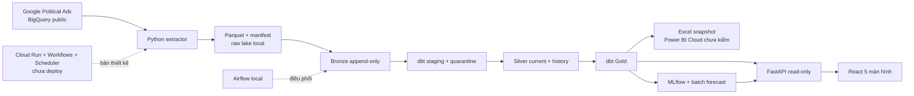
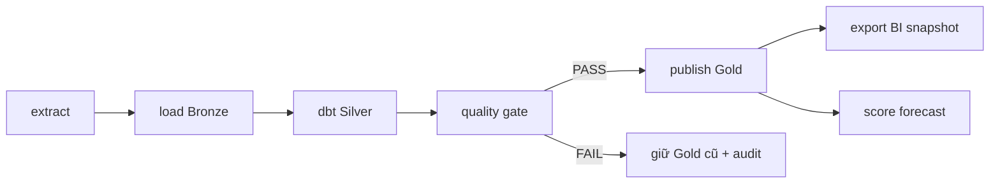
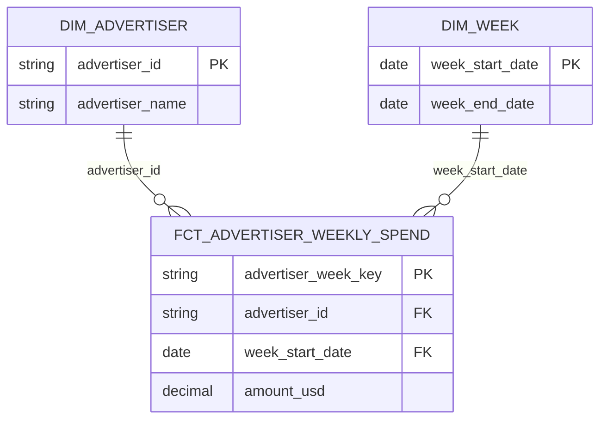
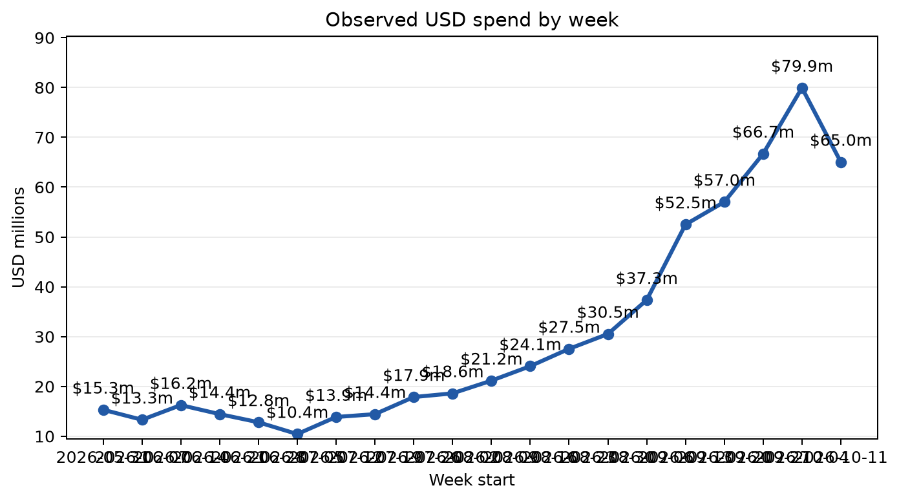
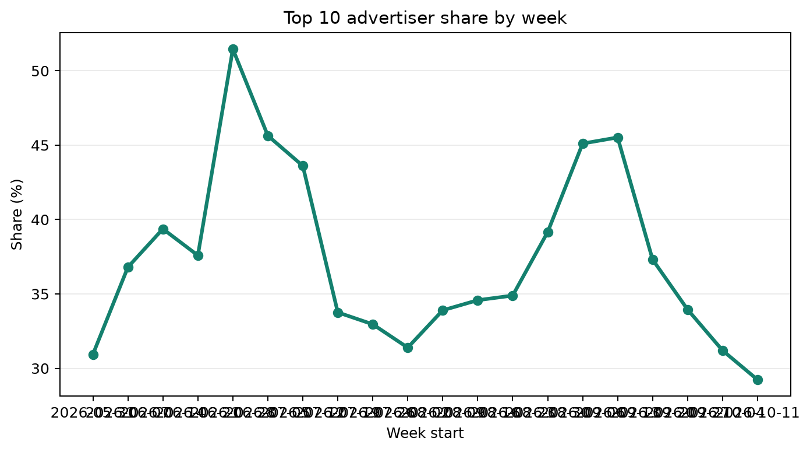
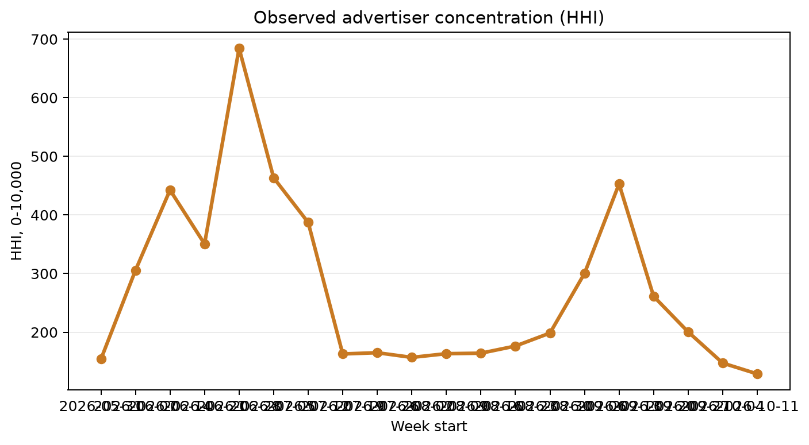
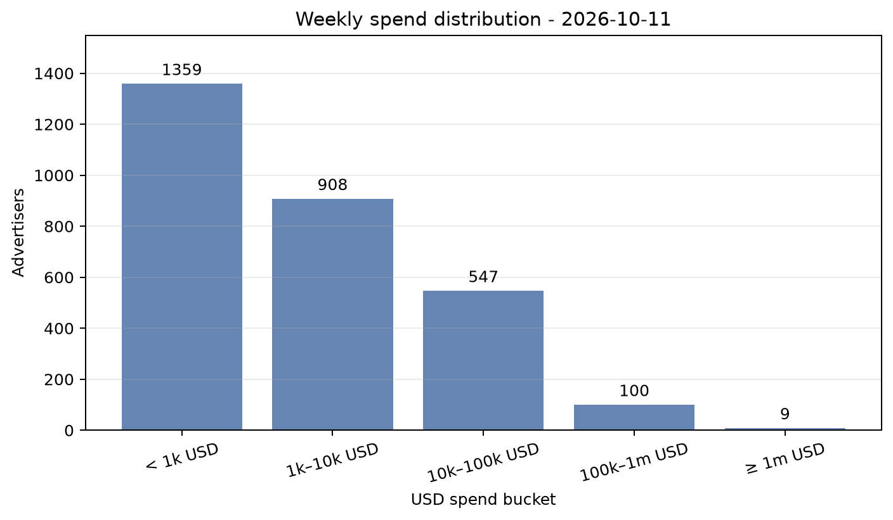
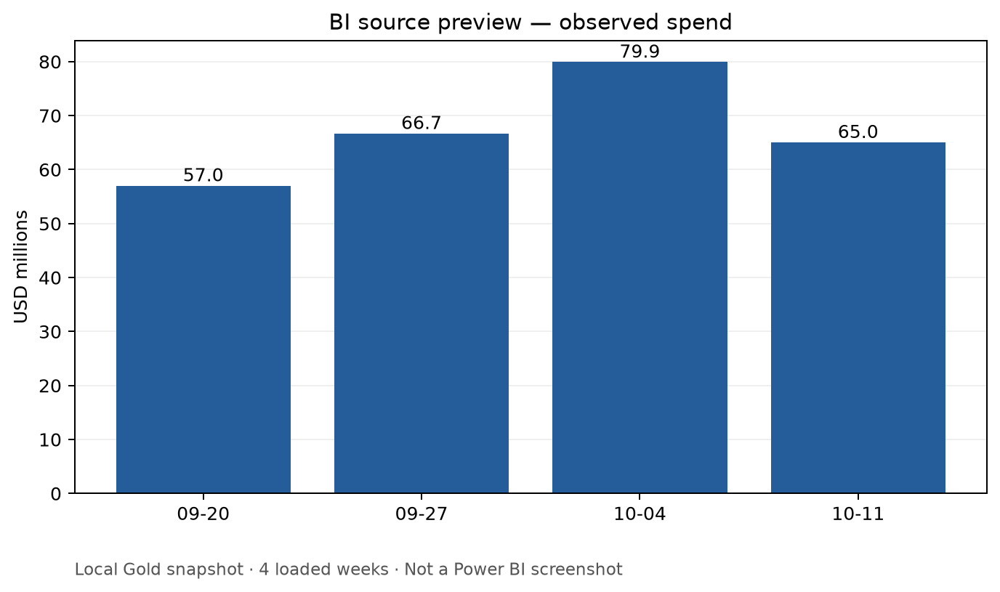
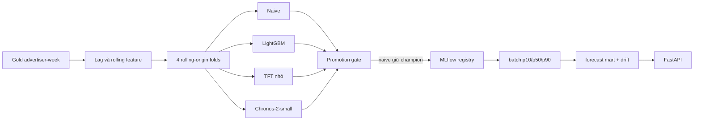
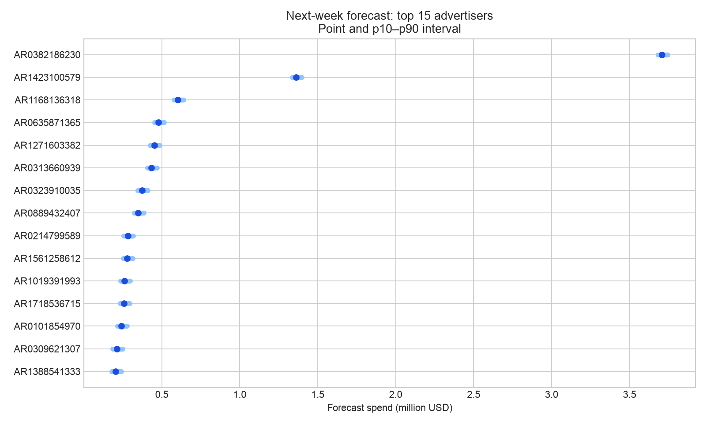

# Bằng chứng và thiết kế

Số ở đây là snapshot đã kiểm trên máy, không phải số liệu live; file JSON, SQL và ảnh bên dưới được commit để kiểm lại

## Nguồn và giới hạn

- Nguồn `bigquery-public-data.google_political_ads`, location `US`; [source inventory](week1/source_inventory.json) lưu schema, bảng và thời điểm kiểm tra
- `advertiser_weekly_spend` có grain ứng viên `advertiser_id × week_start_date`, cột `spend_usd` nhưng không có country/region
- `advertiser_geo_spend` có địa lý nhưng không có tuần, không join vào weekly fact để tạo trend địa lý giả
- `creative_stats` có khoảng spend/impressions và ad ID; không cộng spend lifetime hoặc midpoint như số chính xác
- Không có click, conversion, revenue nên không tính CTR, ROAS hay tác động bầu cử
- [SQL profiling tuần 1](../sql/week1/) và [JSON kết quả](week1/) là snapshot của nguồn tại thời điểm kiểm tra, không phải toàn bộ data lake
- 20 raw snapshot hiện có từ 2026-05-31 đến 2026-10-11; manifest chứa query hash, job ID, bytes, row count và checksum

## Kiến trúc







`dim_advertiser` là Type 1, dùng tên mới nhất quan sát được; fact và mọi mart không cộng Silver history nhiều phiên bản

```text
raw Parquet → bronze.weekly_raw → stg_weekly → valid_weekly / quarantine_weekly
                                        → silver_history → silver.weekly_current
                                        → fct_advertiser_weekly_spend
                                          ├─ mart_spend_trend_weekly → mart_bi_weekly → Excel
                                          ├─ mart_advertiser_summary → mart_api_advertiser → API
                                          └─ ML features → forecast_history/current → API
```

## Metric dictionary

| Metric | Công thức và grain | Đơn vị / caveat |
| --- | --- | --- |
| `amount_usd` | Spend của một advertiser × tuần trong Silver current | USD, không trộn currency khác |
| `total_spend_usd` | `SUM(fact.amount_usd)` theo tuần hoặc toàn cửa sổ đã tải | USD quan sát được, không phải US-only |
| `advertiser_count` | `COUNT(*)` trên fact key unique theo tuần | Số advertiser có bản ghi, không phải toàn nguồn |
| `wow_change_pct` | `100 × (spend_t / spend_t-1 − 1)` | Chỉ khi hai tuần liền nhau và tuần trước > 0 |
| `top10_share_pct` | `100 × top10 advertiser spend / weekly spend` | Top 10 tính lại theo đúng filter tuần |
| HHI quan sát | `10.000 × SUM((advertiser_spend / weekly_spend)^2)` | Chỉ trong nhóm được quan sát, không phải thị trường toàn ngành |
| `forecast point/p10/p50/p90` | Dự báo một advertiser × target week × cutoff × model version | USD cho cohort được score, thiếu lịch sử thì abstain |

## Dữ liệu và chất lượng

- [Week 16 audit](week16/evidence.json): Gold 31.453 advertiser-week rows, 20 tuần, tổng 609.155.500 USD, 0 duplicate fact key, 16/16 DQ PASS
- `make week6` build candidate warehouse, test dbt Silver 9/9 và Gold 32/32, giữ Gold cũ khi blocking check fail
- Backfill/replay cùng raw run trả `SKIPPED`, source correction có run ID mới và giữ history
- Schema drift kiểm trên metadata Parquet trước khi publish; quarantine giữ reason, `raw = valid + quarantine`
- Airflow local có 5 task `extract → load → transform → quality → publish`, logical date thứ Hai UTC chọn raw Chủ nhật trước đó
- Test mô phỏng transform fail lần đầu rồi retry cùng candidate; clear run đã PASS là no-op, không nhân đôi current key
- `tests/test_week6_publish.py`, `tests/test_week7_flow.py`, `tests/test_cloud_publish.py` chứa fault injection; cloud tests dùng mock, không phải execution thật

## Business và BI

Đọc [evidence](week9/evidence.json) cùng [SQL kiểm chứng](week9/sql/) khi trích số

- Tuần 2026-10-04 → 2026-10-11: spend từ 79.932.300 xuống 65.042.100 USD, WoW −18,63%; advertiser có bản ghi từ 2.629 lên 2.923
- Top 10 share tuần cuối 29,23%, HHI quan sát 128,85; không suy ra mức tập trung toàn thị trường
- Tuần cuối có 1.359 advertiser dưới 1.000 USD và 9 advertiser từ 1 triệu USD trở lên; bucket count cộng lại bằng 2.923
- Movers chỉ so nhóm có bản ghi ở cả hai tuần, không biến tuần thiếu thành spend 0
- Targeting chưa đủ nguồn, trang Geo & Targeting chỉ báo unavailable, không vẽ bản đồ hay targeting ROI giả









- `make week10` xuất workbook local có FactSpend, DimAdvertiser, DimWeek, DQScorecard, TargetingStatus và SnapshotInfo
- [Đối soát Excel ↔ SQL](week10/evidence.json) đạt 6/6 KPI, workbook hash khớp Gold hiện tại
- Power BI Cloud report, quan hệ, DAX và ảnh thật chưa được kiểm trên đúng tài khoản; không gọi Excel preview là dashboard Power BI
- Khi import Power BI, quan hệ `DimAdvertiser[advertiser_id]` và `DimWeek[week_start_date]` tới FactSpend đều 1:n, single direction; `Spend USD = SUM(FactSpend[amount_usd])` và `Advertisers Observed = DISTINCTCOUNT(FactSpend[advertiser_id])`
- Filter tuần, đơn vị USD và SnapshotInfo phải hiện trên mọi trang; Data Quality không join vào fact vì khác grain



## ML và forecast



- Cohort 100 advertiser chọn từ 8 tuần đầu, 4 folds × 2 tuần test, cùng 578 advertiser-week rows có nhãn và đủ lag
- Rolling one-week-ahead: ở test week thứ hai có thể dùng actual của test week thứ nhất làm lag, weights không đổi trong fold
- Tuần thiếu là NULL, không phải 0; feature dùng lag/rolling quá khứ, có test chống target leakage

| Model | MAE USD | WAPE | Coverage p10–p90 | Width USD | Peak RSS |
| --- | ---: | ---: | ---: | ---: | ---: |
| Chronos-2-small zero-shot | 60.623 | 32,07% | 73,70% | 201.163 | 338 MiB |
| Naive last-week | 61.753 | 32,67% | 72,66% | 46.484 | 116 MiB |
| TFT nhỏ | 67.653 | 35,79% | 67,82% | 211.466 | 433 MiB |
| LightGBM point + quantile | 88.729 | 46,94% | 75,43% | 168.726 | 193 MiB |

- [Week 11 baseline](week11/evidence.json) và [Week 12 cùng protocol](week12/evidence.json) lưu folds, metrics, hashes, runtime và MLflow run IDs
- Chronos giảm MAE 1,83% so naive nhưng không đạt gate giảm ≥5%, coverage ≥75% và width ≤2× naive, nên giữ naive
- Đây là backtest 20 tuần trên cohort nhỏ, không đủ kết luận mô hình sẽ thắng lâu dài hoặc dự báo kết quả bầu cử


- [Forecast mart evidence](week13/evidence.json): 73 live forecast cho target 2026-10-18, 27 abstain, 0 duplicate forecast ID; actual live chưa có
- Retrospective có 73 actual, MAE 66.401 USD, WAPE 40,25%, coverage 61,64%; 1 spike alert là cờ heuristic chứ không phải kết luận gian lận
- Model version, run ID, cutoff và source fingerprint nằm cùng forecast; source correction không xóa evaluation cũ



## Platform, benchmark và bảo mật

- FastAPI read-only có overview, trends, advertisers, geography status, forecasts và pipeline health; filter whitelist, pagination, timeout, cache, CORS và request ID
- React có Overview, Advertiser Explorer, Geography & Targeting, Forecasts, Pipeline Health; browser chỉ gọi API qua Vite proxy, không gọi BigQuery
- [API ↔ SQL](week14/evidence.json) và [web ↔ API ↔ SQL](week15/evidence.json) khớp 3 KPI cùng hash Gold, cùng filter 2026-10-11
- [Ảnh web desktop](week15/screenshots/01_overview_local.png), [Advertisers](week15/screenshots/02_advertisers_local.png), [Forecasts](week15/screenshots/04_forecasts_local.png), [Pipeline Health](week15/screenshots/05_pipeline_local.png), [mobile](week15/screenshots/06_overview_mobile_local.png)

| Phép đo trên Mac M3 8 GB | Kết quả | Lưu ý |
| --- | ---: | --- |
| `time -l make week6` | 27,88 giây, max resident 269 MB | 20 raw snapshot đã có, không query BigQuery trong lượt này |
| BigQuery processed / billed | 1.388.177.868 / 1.405.091.840 bytes | Tổng job stats trong 20 manifest lịch sử, không phải query mới |
| API overview p50 / p95 | 1,29 / 2,32 ms | 50 request localhost tuần tự, warm cache, không đại diện cloud |
| API RSS | 74,4 MiB | Process server sau benchmark |
| Python / web | 63 pass / 3 fixture + 1 live pass | Live cần Gold và API; fixture không cần secret |
| Terraform | fmt + validate pass | Chưa apply |
| Secret scan | PASS | Pattern high-signal trên tracked files, không thay GitHub secret scanning |
| Cloud cost/log | N/A | Project chưa bật billing, không có job cloud để đo |

- CI chạy Python `make check` + secret scan, React lint/build/Playwright fixture và Terraform validate
- IAM Terraform tách `ads-extract` (jobUser + raw bucket create/view), `ads-publish` (jobUser + dataset edit + raw view), workflow executor và scheduler invoker; runtime không dùng owner project
- Scheduler mặc định paused, cloud deployment chưa chạy thật, không có Cloud Run ID/log hoặc hóa đơn để tuyên bố
- `data/raw`, `data/tmp`, `data/exports`, model weights, `.env` và credential đều được ignore; clone mới vẫn chạy `make smoke`

## Demo phỏng vấn 5–7 phút

- 0:00–1:00 — nguồn public, grain advertiser-tuần, giới hạn không có CTR/ROAS
- 1:00–2:00 — manifest → Bronze/Silver/Gold, audit và quality gate
- 2:00–3:00 — trend, top share, HHI và Excel snapshot đối soát SQL
- 3:00–4:00 — rolling folds, bốn model, lý do giữ naive champion
- 4:00–5:30 — API docs, React filter/drill-down, forecast và error state
- 5:30–6:30 — evidence hash/KPI, p50/p95, giới hạn cloud/Power BI

## CV, ghi đúng phạm vi

- Xây batch pipeline idempotent cho 20 snapshot Google Political Ads, đối soát 31.453 advertiser-week qua Bronze/Silver/Gold với 16 quality checks
- Thiết kế dbt dimensional marts và đối soát 6 KPI SQL–Excel, 3 KPI SQL–FastAPI–React bằng evidence có hash warehouse
- So naive, LightGBM, TFT và Chronos trên rolling-origin folds, giữ baseline sau promotion gate, triển khai batch forecast/drift monitor local
- Xây React dashboard 5 màn hình, FastAPI read-only, 63 Python tests và Playwright fixture/live trên Mac 8 GB

Không ghi “đã deploy cloud”, “Power BI Cloud khớp” hay “production-ready” khi chưa có bằng chứng
