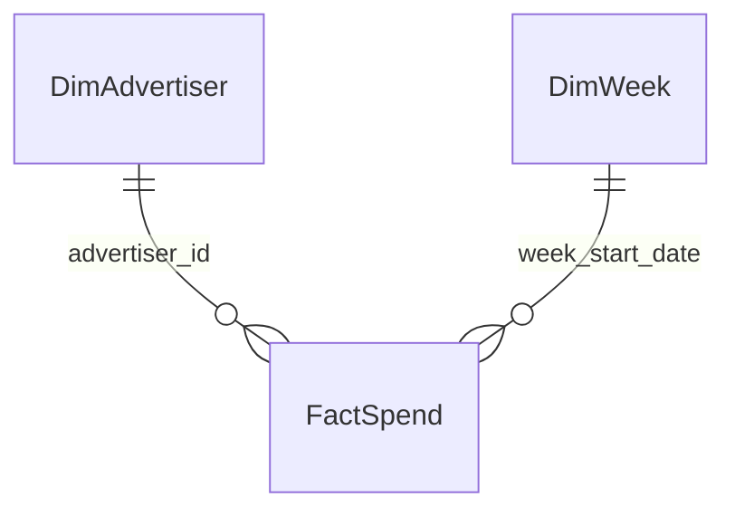

# Tuần 10 — Power BI Cloud

## Trạng thái thật

- Đã xong offline: export Gold thành Excel snapshot, kiểm checksum, 6 KPI Excel ↔ SQL, ảnh biểu đồ nguồn
- Chưa xong trên Power BI: import semantic model, quan hệ, DAX, bốn trang report, drill-through, ảnh chụp report và đối soát KPI trong UI
- Lý do: phiên Power BI đang thấy đăng nhập `Hoang.ND235938@sis.hust.edu.vn`; không upload dữ liệu vào tài khoản chưa được chủ project chọn
- Không có report URL, refresh schedule hay screenshot Power BI để dẫn chứng ở thời điểm commit này
- BigQuery project chưa bật billing, nên đường nạp phù hợp hiện tại là **Excel snapshot tĩnh**, không phải BigQuery DirectQuery hoặc refresh tự động

## Snapshot đã chuẩn bị

```bash
python -m pip install -e '.[dev]'
make week10
```

- File local: `data/exports/powerbi/political_ads_gold_2026-10-11.xlsx`, không commit vì là bản data export
- Manifest local: `data/exports/powerbi/snapshot_manifest.json`
- Sáu Excel Table: `FactSpend`, `DimAdvertiser`, `DimWeek`, `TargetingStatus`, `DQScorecard`, `SnapshotInfo`
- Fact grain: advertiser × tuần; chỉ là USD spend quan sát trong bốn tuần đã tải, **không phải spend riêng Mỹ hoặc toàn bộ lịch sử**
- Mỗi lần export, đối chiếu `file_sha256` và `warehouse_sha256`; nếu Gold đã đổi, không dùng workbook cũ
- Kết quả local có trong [evidence.json](evidence.json); `PASS_LOCAL_ONLY` không có nghĩa Power BI đã khớp


## Mô hình cần tạo trong Power BI



- Quan hệ `DimAdvertiser[advertiser_id]` → `FactSpend[advertiser_id]`, 1:n, single direction
- Quan hệ `DimWeek[week_start_date]` → `FactSpend[week_start_date]`, 1:n, single direction
- `amount_usd`: Fixed decimal, 2 chữ số; các cột `*_date`: Date; `SnapshotInfo` và `DQScorecard` không nối vào Fact
- Không nối `TargetingStatus` vào Fact: hai bảng khác grain, trạng thái nguồn không phải dimension phân tích spend
- Đặt tiêu đề report `Political Ads — observed USD spend (snapshot through 2026-10-11)`; hiển thị trạng thái snapshot trên mọi trang

### DAX dùng sau khi import

```dax
Spend USD = SUM(FactSpend[amount_usd])

Advertisers Observed = DISTINCTCOUNT(FactSpend[advertiser_id])

Advertiser-Weeks = COUNTROWS(FactSpend)

Last Visible Week = MAX(DimWeek[week_start_date])

Last Week Spend USD =
VAR CurrentWeek = [Last Visible Week]
RETURN CALCULATE(
    [Spend USD],
    REMOVEFILTERS(DimWeek),
    DimWeek[week_start_date] = CurrentWeek
)

Previous Week Spend USD =
VAR PreviousWeek = [Last Visible Week] - 7
RETURN CALCULATE(
    [Spend USD],
    REMOVEFILTERS(DimWeek),
    DimWeek[week_start_date] = PreviousWeek
)

WoW Spend % =
DIVIDE([Last Week Spend USD] - [Previous Week Spend USD],
       [Previous Week Spend USD])

Top 10 Share % =
VAR Ranked = TOPN(
    10,
    SUMMARIZE(FactSpend, FactSpend[advertiser_id],
              "AdvertiserSpend", [Spend USD]),
    [AdvertiserSpend], DESC,
    FactSpend[advertiser_id], ASC
)
RETURN DIVIDE(SUMX(Ranked, [AdvertiserSpend]), [Spend USD])
```

- `WoW Spend %` dùng tuần cuối trong filter và tuần trước cách 7 ngày; nếu thiếu tuần trước thì BLANK, không điền 0
- `Top 10 Share %` tính top 10 trên toàn bộ kỳ đang lọc; để khớp số Tuần 9 là `29,23%`, chọn đúng một tuần `2026-10-11`
- Nếu editor DAX không cho dùng `[Spend USD]` trong `SUMMARIZE`, thay bằng `SUM(FactSpend[amount_usd])` trong cột `AdvertiserSpend`

## Bố cục report cần hoàn tất

| Trang | Visual | Filter và giới hạn |
| --- | --- | --- |
| Executive | Cards spend, advertiser, WoW; trend theo tuần; top-10 share | Slicer tuần; nhãn observed USD / static snapshot |
| Advertiser | Top advertiser, bảng advertiser-week, drill-through theo `advertiser_id` | Không biến tuần không có record thành spend 0 |
| Geography & Targeting | Thẻ `Targeting data unavailable`, bảng `TargetingStatus` | Chưa vẽ bản đồ/targeting share vì nguồn creative chưa vào Silver |
| Data Quality | DQ PASS/FAIL, bảng kiểm, SnapshotInfo, ngày export | Phân biệt ngày kiểm tra nguồn với ngày export |

Không dùng chart ROAS, CTR, conversion hay US spend: snapshot không có các dữ liệu đó

## Đối soát tối thiểu khi đã đăng nhập đúng tài khoản

Sau khi import vào workspace được chọn, tạo ba card và một table với filter tuần `2026-10-11`, rồi chụp UI:

| Metric | SQL Gold | Excel snapshot | Power BI cần đọc được |
| --- | ---: | ---: | ---: |
| Tổng spend cả 4 tuần | 268.708.700 USD | 268.708.700 USD | Chưa kiểm |
| Advertiser cả 4 tuần | 3.200 | 3.200 | Chưa kiểm |
| Spend tuần 2026-10-11 | 65.042.100 USD | 65.042.100 USD | Chưa kiểm |
| Advertiser tuần 2026-10-11 | 2.923 | 2.923 | Chưa kiểm |
| Top 10 spend tuần 2026-10-11 | 19.011.200 USD | 19.011.200 USD | Chưa kiểm |

- SQL nguồn trong `scripts/week10_verify_snapshot.py`; evidence ghi cả hai phía và checksum
- Report Power BI chỉ được đánh dấu hoàn thành khi 3 KPI trở lên khớp cùng filter, drill-through chạy được và lưu ảnh chụp report thật vào `reports/week10/powerbi/`
- Không gọi reload trang là refresh nguồn; để cập nhật snapshot phải export lại workbook, import/replace có kiểm soát và đối soát lại
