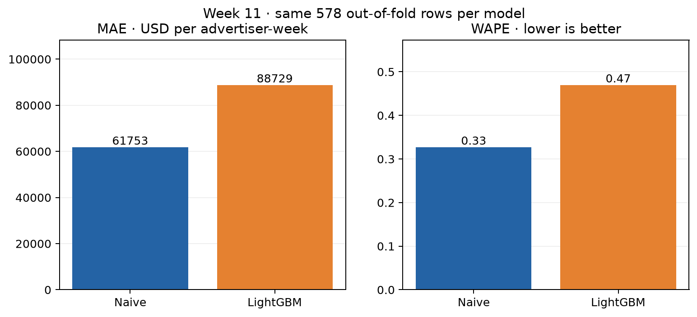
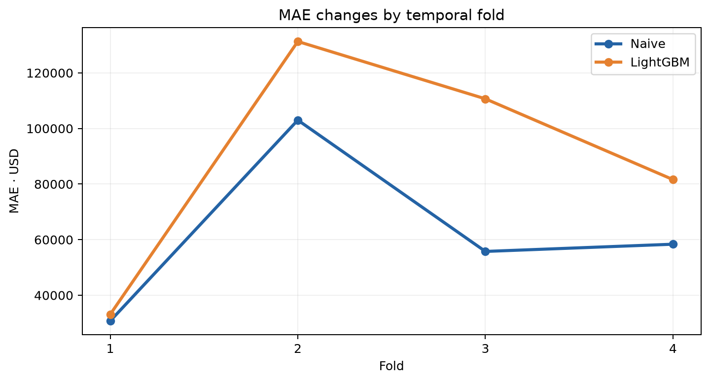
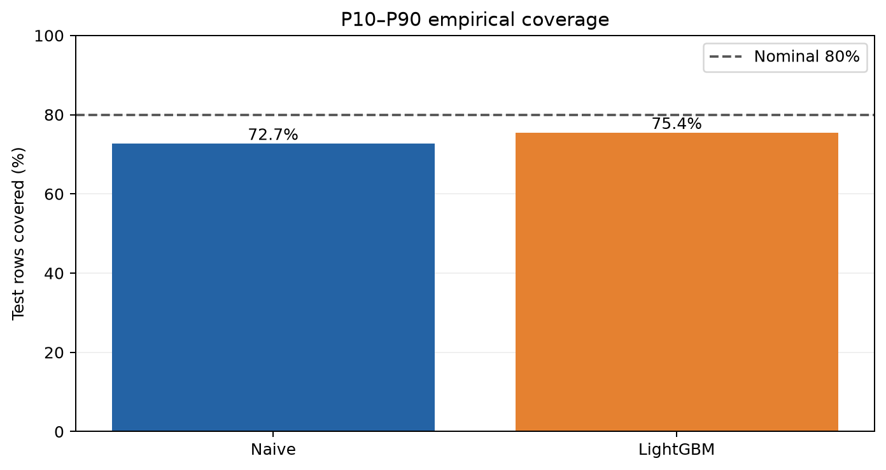
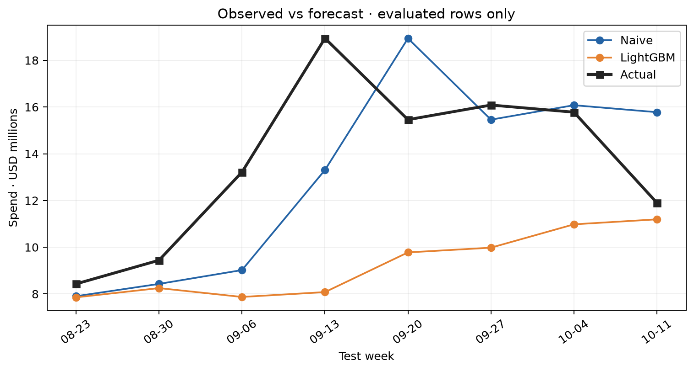

# Tuần 11 — ML baseline và temporal validation

## Kết luận

- **Đã hoàn thành baseline thử nghiệm**, chưa đưa model vào production
- Gold có 20 tuần liên tiếp từ `2026-05-31` đến `2026-10-11`; cohort 100 advertiser được chọn chỉ bằng 8 tuần đầu
- 4 rolling-origin folds × 2 tuần test; mỗi model đánh giá trên cùng 578 advertiser-week rows
- Naive last-week thắng LightGBM point về MAE và WAPE ở cả 4 folds; **giữ naive làm benchmark cho Tuần 12**
- Chỉ 20 tuần lịch sử và test rows có đủ bốn lag; không khái quát kết quả cho mọi advertiser hay chu kỳ chính trị dài hạn
- Quyết định ở Tuần 1 ưu tiên cohort 52 tuần quan sát; đây là cohort ngắn hơn để kiểm nghiệm pipeline ML, không thay thế thí nghiệm 52 tuần

## Tái tạo trên Mac M3 8 GB

```bash
cd /Users/hoangyugi001/Documents/Coder/political-ads-intelligence-platform
python3.13 -m venv data/tmp/week11/venv
data/tmp/week11/venv/bin/python -m pip install --only-binary=:all: -r requirements-week11.txt
brew install libomp  # chỉ cần nếu chưa có; LightGBM cần libomp trên Mac
make week11
```

- Python 3.13 venv tách khỏi `.venv` Python 3.14 của pipeline
- DuckDB giới hạn 1 GB và 2 threads; LightGBM dùng `n_jobs=2`, train các model tuần tự
- `make week11` tạo feature table, fold manifest, predictions, scores, leaderboard, MLflow local rồi kiểm tra và vẽ biểu đồ
- Output chi tiết trong `data/tmp/week11/` được `.gitignore`; [evidence.json](evidence.json) và bốn PNG được commit
- MLflow dùng SQLite tại `data/tmp/week11/mlflow.db`; mở UI bằng `data/tmp/week11/venv/bin/mlflow ui --backend-store-uri "sqlite:///$PWD/data/tmp/week11/mlflow.db" --host 127.0.0.1 --port 5001`
- Mỗi lần chạy có `batch_run_id` riêng; evidence xác nhận đúng 8 MLflow runs cho lần chạy đó dù database có thể giữ runs cũ

## Feature và validation

```text
Gold fact advertiser × tuần
  → cohort chọn từ 8 tuần đầu, tối đa 100 advertiser
  → calendar grid, tuần không có bản ghi = NULL
  → lag 1/2/4 và rolling mean 4 từ các tuần trước
  → 4 folds: train mở rộng, test 2 tuần liên tiếp
  → naive / LightGBM point + p10/p50/p90
  → out-of-fold metrics, MLflow, evidence và charts
```

- [Feature SQL](../../sql/week11/features.sql) không dùng giá trị tuần hiện tại hoặc tương lai làm feature; unit test thay đổi `y` tương lai và xác nhận feature quá khứ không đổi
- Chỉ giữ test rows có nhãn và đủ bốn tuần trước có quan sát; **không gán tuần thiếu bằng 0**
- Bài toán đánh giá là *rolling one-week-ahead*: ở tuần test thứ hai có thể dùng actual của tuần test thứ nhất làm lag; model weights cố định trong fold
- Không diễn giải hai tuần trong một fold là forecast hai bước phát ra tại cùng một origin
- Naive interval dùng quantile residual từ **train fold**; LightGBM train point và ba quantile riêng, sau đó sửa quantile crossing bằng sắp xếp p10/p50/p90 và log crossing rate
- MASE dùng mean absolute one-step naive error gộp trên train fold làm scale; leaderboard tính trung bình row-wise của tỷ số lỗi/scale tương ứng fold
- WAPE tính từ tổng absolute error chia tổng absolute actual trên toàn bộ out-of-fold rows, không lấy trung bình WAPE từng fold

| Fold | Train kết thúc | Test weeks | Train rows | Test rows |
| --- | --- | --- | ---: | ---: |
| 1 | 2026-08-16 | 2026-08-23, 2026-08-30 | 746 | 150 |
| 2 | 2026-08-30 | 2026-09-06, 2026-09-13 | 896 | 145 |
| 3 | 2026-09-13 | 2026-09-20, 2026-09-27 | 1.041 | 144 |
| 4 | 2026-09-27 | 2026-10-04, 2026-10-11 | 1.185 | 139 |

## Leaderboard out-of-fold

| Model | MAE USD | WAPE | MASE | Pinball p10 | Pinball p50 | Pinball p90 | Coverage p10–p90 | Mean width USD |
| --- | ---: | ---: | ---: | ---: | ---: | ---: | ---: | ---: |
| Naive last-week | 61.753 | 32,67% | 1,93 | 25.127 | 30.877 | 30.098 | 72,66% | 46.484 |
| LightGBM point + quantile | 88.729 | 46,94% | 2,70 | 14.360 | 44.456 | 40.830 | 75,43% | 168.726 |

- MAE của LightGBM cao hơn naive khoảng 43,7%; WAPE cao hơn 14,27 điểm phần trăm
- Coverage của LightGBM gần mức danh nghĩa 80% hơn, nhưng interval trung bình rộng khoảng 3,6 lần; chưa phải trade-off hấp dẫn
- Pinball p10 của LightGBM thấp hơn, song p50 và p90 kém hơn; không chọn model bằng một metric riêng lẻ
- MASE > 1 cho cả hai vì scale học từ train thấp hơn mức lỗi ở các test weeks; không tự suy ra model bị lỗi code









Biểu đồ cuối cộng spend trên các **test rows đủ lag** ở từng tuần, không phải toàn bộ Gold spend của tuần đó; số advertiser đủ điều kiện thay đổi theo tuần

## Bằng chứng và giới hạn

- [evidence.json](evidence.json) chứa hash Gold, hash feature SQL, hash predictions, `batch_run_id`, 4 folds, leaderboard và xác nhận test keys giống nhau
- `scripts/week11_evidence.py` chặn duplicate test key, lệch actual, train chồng test, khoảng quantile đảo thứ tự và thiếu MLflow run
- `PATH="$PWD/.venv/bin:$PATH" make check` chạy xanh 45 tests; test SQL synthetic kiểm tra lag và missing-week policy
- Chưa lưu model vào registry hoặc công bố forecast để dùng thật; Tuần 12 mới so với deep learning/zero-shot trên đúng protocol
- Snapshot Power BI Tuần 10 xuất trước đợt backfill 20 tuần nên **đã cũ so với Gold hiện tại**; cần export và đối soát lại trước khi dùng cho dashboard
