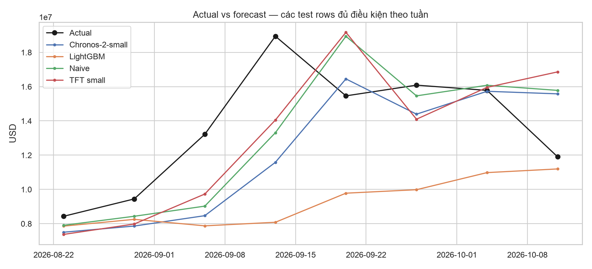
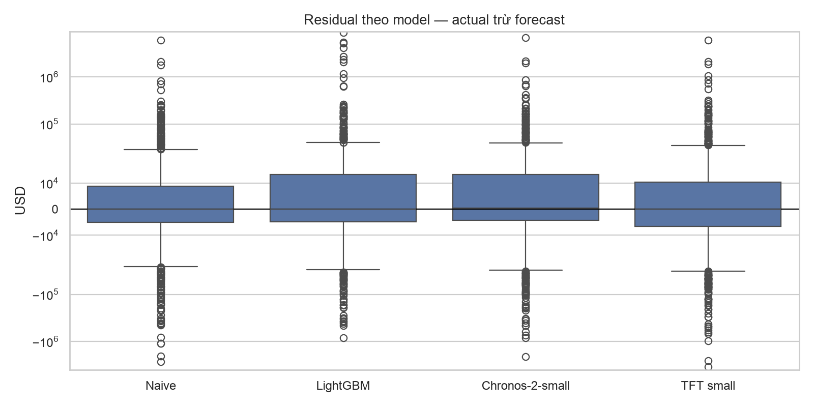
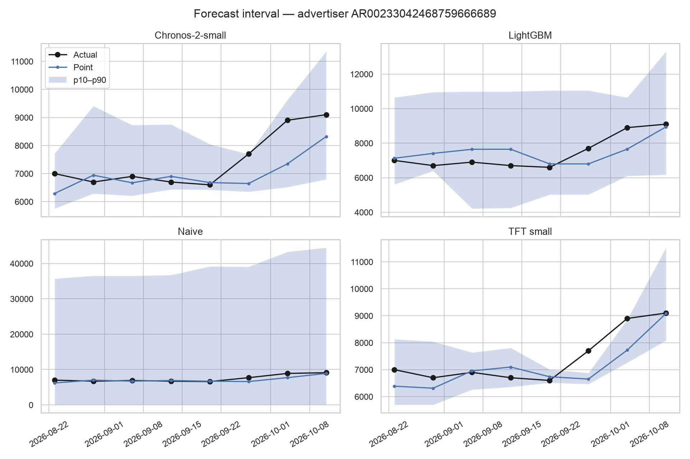

# Tuần 12 — Deep learning và model hiện đại

## Kết luận

- Hoàn thành benchmark offline của naive, LightGBM, TFT nhỏ và Chronos-2-small zero-shot trên cùng 578 advertiser-week test rows, 4 temporal folds
- Chronos có MAE thấp nhất: **60.623 USD**, giảm **1,83%** so với naive **61.753 USD**
- Chronos **không qua promotion gate**: cần giảm MAE ít nhất 5%, coverage ≥ 75%, interval width ≤ 92.969 USD; thực tế coverage 73,70% và width 201.163 USD
- TFT đạt MAE 67.653 USD, coverage 67,82%, width 211.466 USD; không thắng naive
- **Giữ naive last-week làm model được khuyến nghị cho Tuần 13**, không ghi Chronos hay TFT là model production

## Input và protocol

- Gold DuckDB và [fold manifest Tuần 11](../week11/evidence.json): 20 tuần liên tiếp, cohort chọn bằng 8 tuần đầu, 4 folds × 2 tuần test
- Grain: advertiser × tuần, target là observed spend USD của tuần kế tiếp
- Hai tuần trong mỗi test fold là rolling one-week-ahead, không phải forecast 2 bước từ một origin
- Model weights TFT cố định trong mỗi test fold; tuần test thứ hai được dùng actual tuần test thứ nhất làm context
- Tuần thiếu là missing, không phải spend bằng 0; Chronos lấy đoạn lịch sử liên tiếp tối đa 16 tuần và dừng ở gap
- TFT dùng encoder 4 tuần, decoder 1 tuần, `EncoderNormalizer`, 6.3 nghìn trainable parameters, 8 epochs mỗi fold, CPU 2 threads
- Kiểm tra chống leakage: đổi target decoder thành 1 tỷ USD ở một test row mỗi fold không làm thay đổi output TFT
- Cả 4 nhóm dùng đúng khóa `(fold, advertiser_id, week_start_date)` và actual của Tuần 11; script chặn thiếu, dư, trùng khóa và quantile crossing

## Leaderboard out-of-fold

| Model | Test rows | MAE USD | WAPE | MASE | Coverage p10–p90 | Mean width USD |
| --- | ---: | ---: | ---: | ---: | ---: | ---: |
| Chronos-2-small zero-shot | 578 | 60.623 | 32,07% | 1,916 | 73,70% | 201.163 |
| Naive last-week | 578 | 61.753 | 32,67% | 1,930 | 72,66% | 46.484 |
| TFT small | 578 | 67.653 | 35,79% | 2,095 | 67,82% | 211.466 |
| LightGBM point + quantile | 578 | 88.729 | 46,94% | 2,702 | 75,43% | 168.726 |

| Model | Pinball p10 | Pinball p50 | Pinball p90 |
| --- | ---: | ---: | ---: |
| Chronos-2-small | 12.357 | 30.311 | 26.203 |
| Naive | 25.127 | 30.877 | 30.098 |
| TFT small | 13.606 | 33.827 | 29.827 |
| LightGBM | 14.360 | 44.456 | 40.830 |

MAE theo fold để tránh chọn model chỉ nhờ một kỳ tốt

| Fold | Naive | LightGBM | TFT | Chronos |
| --- | ---: | ---: | ---: | ---: |
| 1 | 30.758 | 33.122 | 33.975 | 32.291 |
| 2 | 103.008 | 131.297 | 105.052 | 108.164 |
| 3 | 55.768 | 110.660 | 65.900 | 41.714 |
| 4 | 58.366 | 81.612 | 66.799 | 61.191 |

## Runtime và bộ nhớ

| Model | Train 4 folds | Inference 578 rows | Peak RSS | Ghi chú |
| --- | ---: | ---: | ---: | --- |
| Naive | 0 s | 0,005 s | 116 MiB | Python process riêng |
| LightGBM | 0,692 s | 0,020 s | 193 MiB | Fit lại 4 models mỗi fold |
| TFT small | 46,390 s | 69,439 s | 433 MiB | CPU, predict từng row; wall process 117,03 s |
| Chronos-2-small | 0 s | 4,933 s | 338 MiB | CPU, batch 4; load cached weights khoảng 1,3 s |

- Peak RSS là toàn bộ process, bao gồm Python runtime, import và dữ liệu; không phải riêng tensor/model weights
- Thời gian baseline đo bằng process Python 3.13 riêng; thời gian Chronos không tính tải weights lần đầu từ Internet
- Thời gian TFT inference cao do tạo dataloader và Lightning predict từng row để giữ đúng rolling origin; không ngoại suy thành throughput của serving đã tối ưu
- Cấu hình Mac Apple Silicon 8 GB RAM chạy tuần tự, không Docker/Airflow đồng thời; số đo máy khác sẽ khác

## Biểu đồ kiểm chứng



Biểu đồ cộng các **test rows đủ điều kiện** theo tuần, không phải tổng Gold spend của mọi advertiser; số rows có thể khác giữa các tuần



Residual là `actual - point`; trục symlog giữ được cả vùng gần 0 lẫn outlier hàng triệu USD, cho thấy MAE tổng bị ảnh hưởng bởi một số advertiser-week rất lớn



Ảnh interval chỉ minh họa một advertiser, không thay thế coverage 578 rows; dải Chronos/TFT rộng hơn naive đáng kể trên toàn bộ test

## Model card và quyết định

- **Ứng dụng dự kiến:** dự báo observed advertiser-week USD spend để hỗ trợ phân tích ngân sách, không dự báo hiệu quả hay tác động chính trị
- **Dữ liệu:** Gold fact của Google Political Ads, 20 tuần quan sát, 100 advertiser trong cohort; chỉ 578 advertiser-week rows có nhãn và đủ lịch sử được đánh giá
- **Model cạnh tranh:** naive last-week, LightGBM point/quantile, TFT nhỏ, Chronos-2-small zero-shot
- **Chronos checkpoint:** `autogluon/chronos-2-small` revision `ddec01313e50b6bc58ebaa92ede81bc24a3d9f9a`; chạy CPU, không fine-tune
- **Promotion gate chốt trước benchmark:** MAE giảm ≥ 5% so với naive, WAPE không tăng, coverage ≥ 75%, mean width ≤ 2 × naive, không fold nào có MAE tệ hơn naive quá 10%
- **Quyết định:** không challenger nào đạt đủ; giữ naive, Chronos chỉ là challenger cho thử nghiệm tiếp
- **Rủi ro:** lịch sử 20 tuần quá ngắn cho seasonality dài hạn, spend từ nguồn có thể là band/ước lượng, cohort không đại diện toàn bộ advertiser, source corrections có thể đổi Gold và metric
- **Không dùng để:** tuyên bố causal impact, dự báo bầu cử, hoặc triển khai tự động khi chưa có giám sát drift và đo lại trên dữ liệu mới

## Tái tạo và bằng chứng

```bash
cd /Users/hoangyugi001/Documents/Coder/political-ads-intelligence-platform
python3.13 -m venv data/tmp/week12/venv
data/tmp/week12/venv/bin/python -m pip install --only-binary=:all: -r requirements-week12.txt
make week12
```

- `make week12` cần output Tuần 11 tại `data/tmp/week11/` và Gold DuckDB tại `data/tmp/week4/warehouse.duckdb`
- Run mới cần Internet để tải Chronos weights lần đầu; sau đó Hugging Face cache nằm trong `data/tmp/week12/hf-cache/`
- [evidence.json](evidence.json) lưu hash Gold, fold manifest, predictions, chart PNG, bốn MLflow run IDs, full metrics, fold scores và runtime
- MLflow experiment: `political_ads_week12` trong SQLite `data/tmp/week11/mlflow.db`; database và raw predictions local được `.gitignore`, còn evidence và PNG được commit
- Test protocol: `tests/test_week12_protocol.py` kiểm tra context không xuyên gap/target và chặn thiếu hoặc trùng test key
