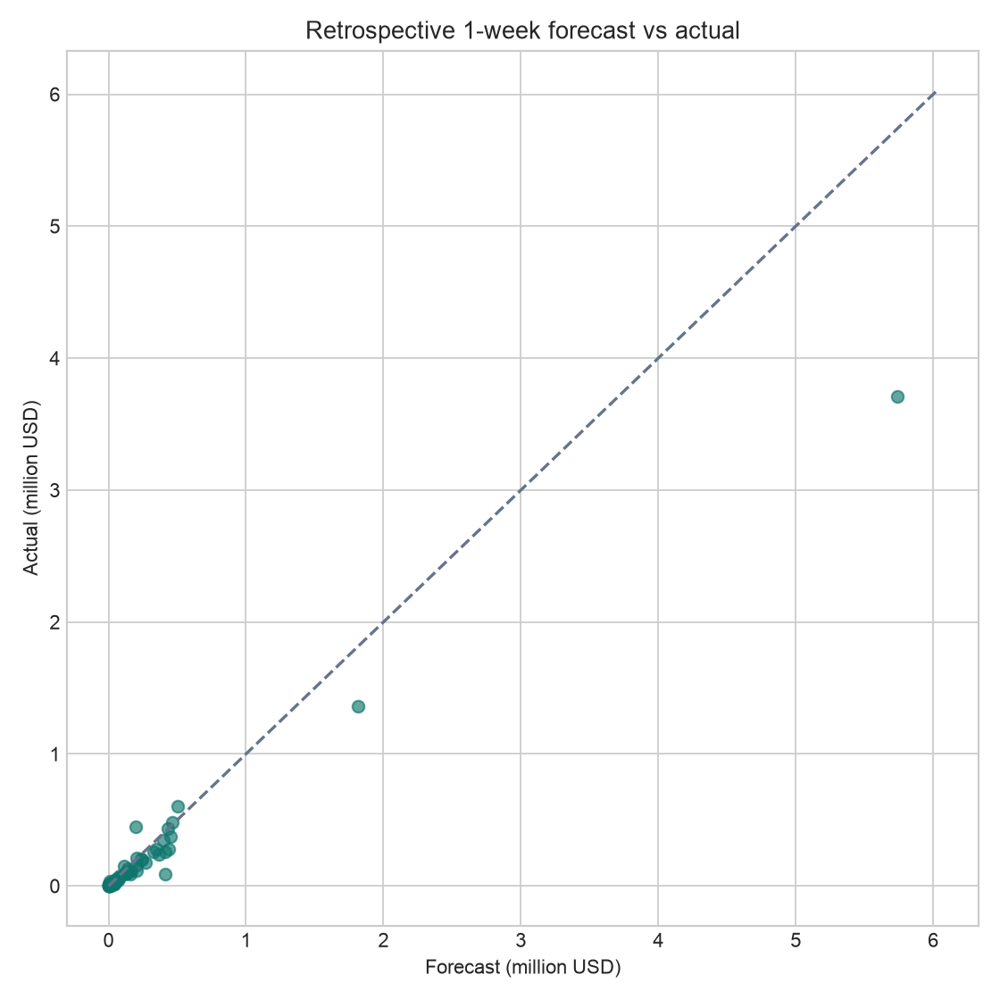
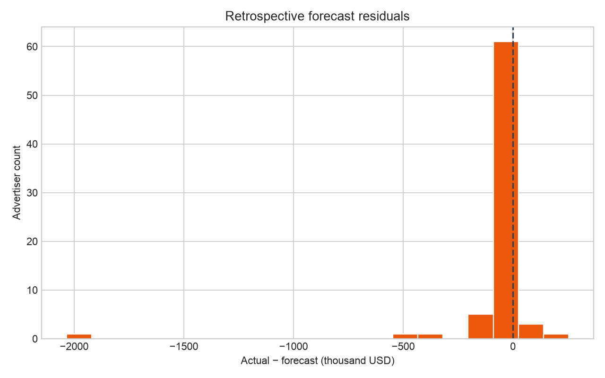

# Tuần 13 — Registry, batch forecast và drift

## Trạng thái

- Pipeline local đã chạy từ Gold qua quality gate, MLflow Registry, forecast mart và monitor
- Power BI Cloud Forecast page chưa được tạo trong tài khoản Power BI của chủ project ở phiên này; ảnh dưới là biểu đồ từ mart local, không phải screenshot Power BI
- Cloud Run/BigQuery production chưa chạy vì project Google Cloud chưa bật billing

## Dữ liệu và model

- Forecast ở grain `advertiser_id × target_week`, đơn vị USD, dự đoán trước một tuần
- Cohort cố định 100 advertiser được chọn bằng 8 tuần đầu trong `sql/week11/features.sql`
- Model giữ lại từ Tuần 12 là `naive_last_week`; point bằng spend tuần trước, p10/p50/p90 từ phân vị residual lịch sử trước hoặc tại data cutoff
- MLflow Registry lưu model version, run ID, cutoff và source fingerprint; alias `Champion` chỉ trỏ version cho Gold mới nhất
- Không suy diễn spend bằng 0 khi advertiser thiếu dữ liệu; ghi số `abstained` và không score advertiser đó
- Model này là baseline có interval thử nghiệm, không phải interval đã hiệu chỉnh; coverage hồi cứu chỉ 61,6% so với nhãn p10–p90 danh nghĩa 80%

## Kết quả đã chạy

| Chế độ | Cutoff | Target | Version | Forecast rows | Abstained | Trạng thái actual |
| --- | --- | --- | ---: | ---: | ---: | --- |
| Retrospective | 2026-10-04 | 2026-10-11 | 2 | 74 | 26 | 73 actual khớp |
| Live | 2026-10-11 | 2026-10-18 | 1 | 73 | 27 | 73 đang chờ |

- Live total point forecast: 12.044.200 USD trên 73 advertiser được score; không phải tổng spend của toàn bộ thị trường hoặc toàn bộ cohort
- Retrospective 73 actual: MAE 66.401 USD, WAPE 40,25%, coverage p10–p90 61,64%
- Monitor ghi 1 spike alert hồi cứu; đây là cờ heuristic (`actual > max(p90, 1,5 × point)` và vượt point hơn 10.000 USD), không phải kết luận hành vi bất thường
- Input PSI 0,037 hồi cứu và 0,091 live, dưới ngưỡng cảnh báo 0,2; so spend cutoff với 8 tuần trước trên cohort có forecast
- Mart có 2 runs, 147 forecast rows, 73 evaluations, 1 alert, 2 drift checks, 0 duplicate forecast ID
- Chạy lại `make week13` giữ nguyên các count trên; test tự động còn kiểm tra source correction tạo evaluation version mới thay vì xóa kết quả cũ






## Luồng chạy

```text
Gold fact + DQ PASS
  → lấy cohort, cutoff, fingerprint
  → đăng ký hoặc tái dùng MLflow model version
  → pin version, score, MERGE forecast_history
  → ghép actual nếu đã xuất hiện
  → evaluation + spike alert + PSI
  → evidence JSON và biểu đồ PNG
```

- Local mart ở `data/tmp/week13/forecast.duckdb`, không commit vì là dữ liệu sinh ra; schema nằm ở `sql/week13/01_forecast_mart.sql`
- `serving.forecast_history` giữ mỗi forecast theo `forecast_id` xác định bởi advertiser, target, cutoff, model version và source fingerprint
- `serving.forecast_current` chọn bản mới nhất trên `advertiser_id × target_week × run_mode`; không cộng các version cũ trong BI
- `serving.forecast_evaluations` giữ actual theo `forecast_id × actual_source_row_hash`, nên source correction có lịch sử
- Khi chưa có actual, không tính MAE/WAPE/coverage live và không biến pending thành 0
- Airflow DAG `political_ads_week13_forecast` chạy thứ Hai sau DAG publish; bắt buộc Gold mới nhất phải trùng Chủ nhật của logical date và quality gate PASS, nếu chưa sẵn sàng thì retry/fail

## Chạy lại từ project root

```bash
python3.13 -m venv data/tmp/week11/venv
data/tmp/week11/venv/bin/python -m pip install -r requirements-week11.txt
make week13
```

Nếu venv Tuần 11 đã tồn tại thì bỏ hai lệnh đầu. Để chứng minh evaluation sau khi actual xuất hiện bằng dữ liệu đã có:

```bash
data/tmp/week11/venv/bin/python scripts/week13_register.py --cutoff 2026-10-04
data/tmp/week11/venv/bin/python scripts/week13_score.py --cutoff 2026-10-04 --retrospective --execute
data/tmp/week11/venv/bin/python scripts/week13_monitor.py
data/tmp/week11/venv/bin/python scripts/week13_evidence.py
make check
```

Version `2` là version hồi cứu trên máy hiện tại; CLI tự tìm version khớp cutoff và fingerprint nên không cần đoán số trên máy mới. Dữ liệu MLflow và DuckDB nằm trong `data/tmp/`, còn MLflow artifacts local ở `mlruns/`, đều không commit. `make week13` tạo lại cả live và demo retrospective khi có Gold và venv

## Forecast page trong Power BI Cloud

Chưa nghiệm thu UI thật. Khi mở đúng workspace và có snapshot mới hoặc BigQuery Gold sau khi bật billing, tạo report page `Forecast` với:

- Card: `SUM(point)` theo `target_week`, kèm `COUNTROWS` forecast và `SUM(abstained_count)` từ run tương ứng; ghi rõ chỉ là cohort được score
- Line/area: p10, p50, p90 và actual theo target week; chỉ hiện actual khi nguồn Gold đã có, không điền 0 cho pending
- Scatter: actual vs point, chỉ filter evaluated forecast, chia theo model version hoặc cutoff
- Table: advertiser, point, p10, p90, actual, absolute error, alert; drill-through theo advertiser
- Data quality/monitor: PSI, số pending, coverage realized và source fingerprint
- Filter bắt buộc `run_mode = LIVE` cho trang vận hành; trang retrospective tách riêng để không cộng trùng 2 chế độ

Power BI cần đối soát ít nhất 3 KPI với `serving.forecast_current` và `serving.forecast_runs` cùng filter: số advertiser được score, tổng point USD và số pending. Không thể gọi trang Power BI là hoàn thành trước khi upload, tạo visual, chụp màn hình và đối soát trên đúng tài khoản

## Bằng chứng

- [`evidence.json`](evidence.json) chứa hash warehouse và evidence Tuần 12, version/run ID/fingerprint, count, metrics, drift và danh sách hình
- Ảnh trong `charts/` được tạo lại từ local forecast mart bằng `scripts/week13_evidence.py`
- Kiểm tra code/test: `make check`; DAG parse bằng Airflow venv Tuần 7
