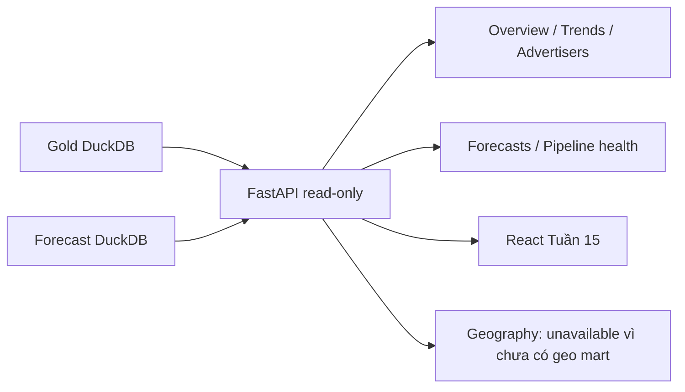

# Tuần 14 — FastAPI local

## Kết quả

- API read-only chạy trên Mac, chỉ đọc Gold và forecast DuckDB, không gửi query lên BigQuery
- Sáu endpoint nghiệp vụ hoạt động, OpenAPI tự sinh tại `/docs` và [openapi.json](openapi.json)
- 3 KPI API khớp SQL trực tiếp trên cùng Gold, xem [evidence.json](evidence.json)
- [examples.json](examples.json) lưu response thật từ local warehouse, không chứa credential hoặc raw rows
- `make week14` chạy 9 test Tuần 14 và tạo lại evidence



## Chạy lại

Từ project root, Python 3.14 trong `.venv`

```bash
.venv/bin/python -m pip install -e '.[dev,api]'
make week14
.venv/bin/python -m uvicorn apps.api.main:app --host 127.0.0.1 --port 8000
```

Mở `http://127.0.0.1:8000/docs` hoặc thử `curl http://127.0.0.1:8000/api/v1/overview`

Đổi đường dẫn DB bằng `API_GOLD_DB` và `API_FORECAST_DB`; CORS qua `API_CORS_ORIGINS`, cache qua `API_CACHE_SECONDS`, timeout query local qua `API_QUERY_TIMEOUT_SECONDS`

## Contract và kiểm soát

| Endpoint | Nguồn | Kiểm soát |
|---|---|---|
| `/api/v1/overview` | `mart_bi_weekly`, `mart_api_advertiser` | filter tuần kiểu `date`, 404 nếu không có tuần |
| `/api/v1/trends` | `mart_bi_weekly` | khoảng ngày hợp lệ, tối đa 104 tuần |
| `/api/v1/advertisers` và `/{advertiser_id}` | `mart_api_advertiser` | sort whitelist, limit ≤ 100, offset ≤ 10.000, ID regex |
| `/api/v1/geography` | chưa có geo Gold | `available=false`, không bịa số liệu |
| `/api/v1/forecasts` | `serving.forecast_current` + Gold fact | chỉ LIVE, limit ≤ 100, actual có thể null |
| `/api/v1/pipeline-health` | `audit.pipeline_runs`, `audit.dq_scorecard` | không cache để thấy lần publish mới |

- SQL được chọn trên server, tham số bind bằng DuckDB; client không truyền tên bảng hoặc raw SQL
- DuckDB read-only, 2 threads, giới hạn RAM 512 MB và watchdog ngắt query quá thời gian
- Cache in-process mặc định 30 giây, CORS chỉ cho origin đã cấu hình, request ID được kiểm tra định dạng
- Không cần `GCP_PROJECT_ID` hoặc ADC khi chạy API local; BigQuery bytes billed bằng 0 cho lần kiểm chứng này

## Đối soát cùng dữ liệu

`evidence.json` lưu hash Gold/forecast để xác định đúng phiên bản dữ liệu, tuần filter `2026-10-11`, 3 cặp SQL–API khớp

| KPI | SQL Gold | API |
|---|---:|---:|
| Spend tuần mới nhất (USD) | 65.042.100 | 65.042.100 |
| Advertiser tuần mới nhất | 2.923 | 2.923 |
| Tổng spend các tuần đã load (USD) | 609.155.500 | 609.155.500 |

Không dùng workbook Tuần 10 để tuyên bố Power BI khớp: workbook đó được export trước backfill, nên khác phạm vi dữ liệu hiện tại

## Chưa xác nhận

- Power BI Cloud chưa được nghiệm thu trên đúng tài khoản, do đó tiêu chí `API = SQL = Power BI` chưa thể đánh dấu đạt
- BigQuery Gold cloud chưa deploy vì project tắt billing theo lựa chọn của chủ project; chưa có BigQuery-backed API hay đo `maximum_bytes_billed` cloud
- Không có screenshot biểu đồ vì Tuần 14 là API, không phải dashboard; bằng chứng phù hợp là OpenAPI, JSON response, test và đối soát SQL
