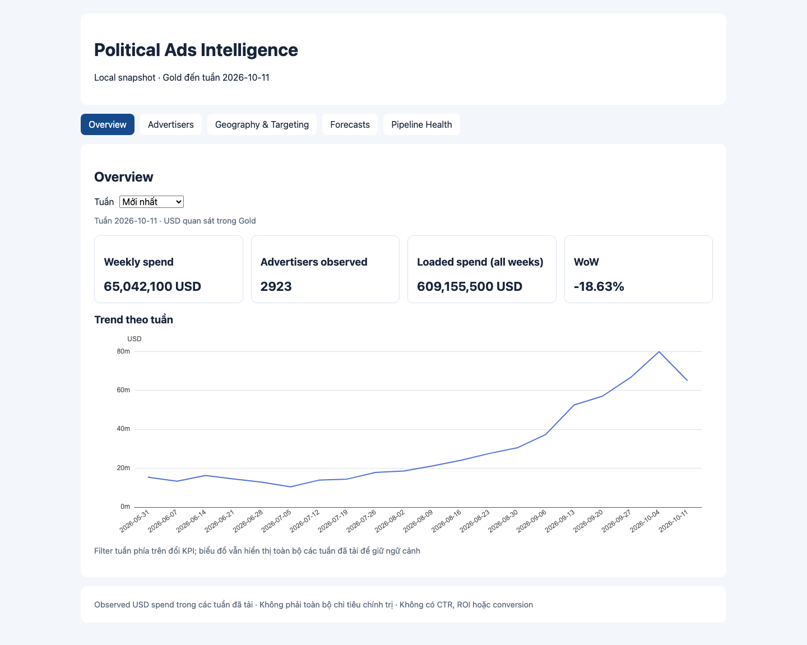
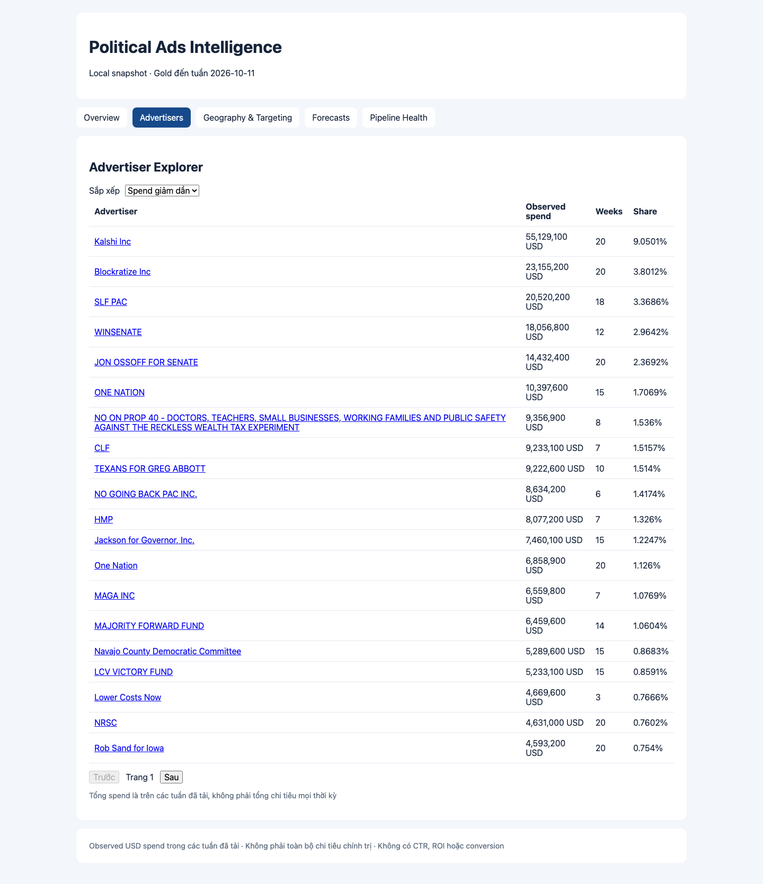
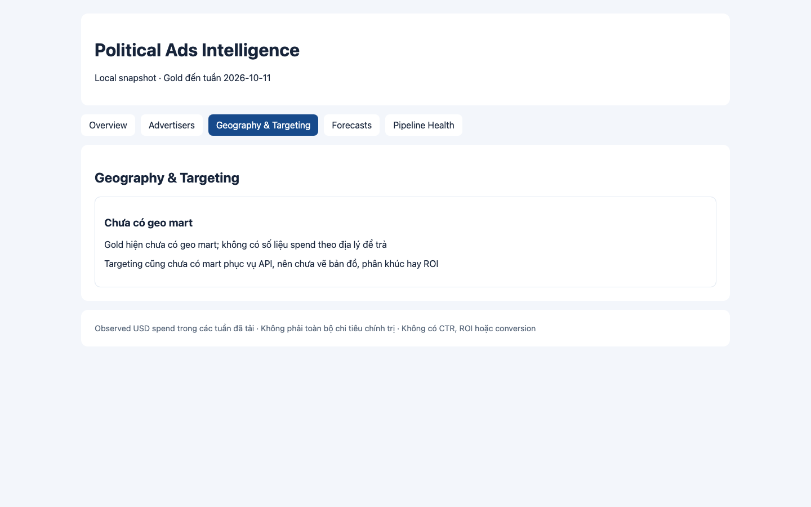
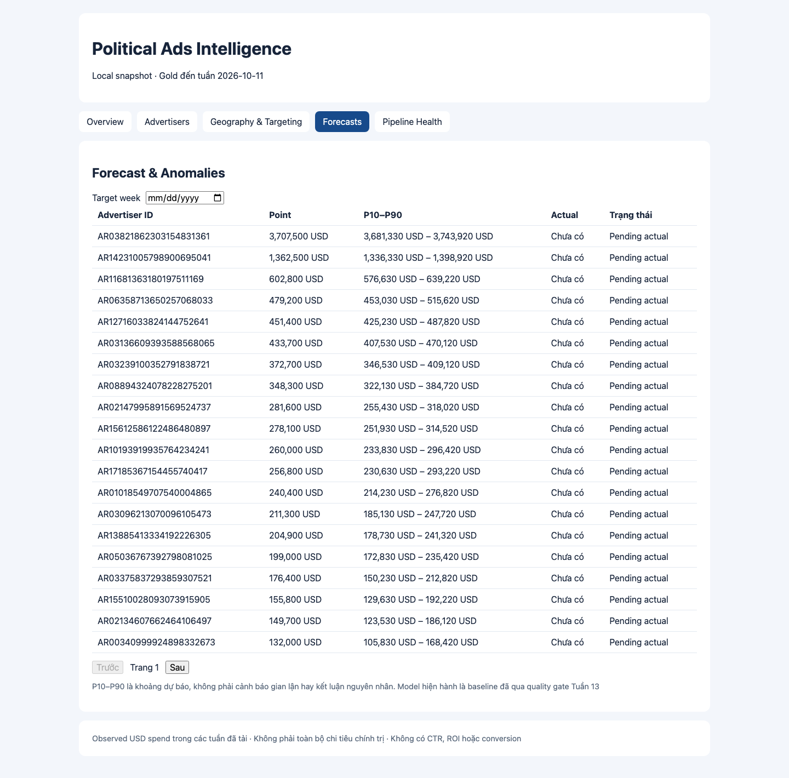
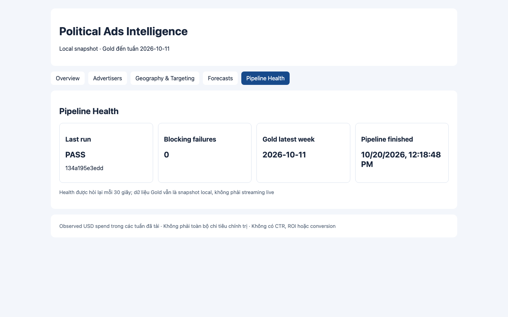
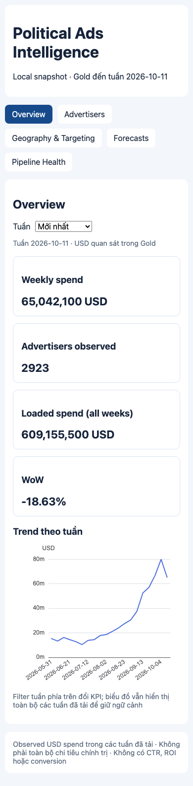

# Tuần 15 — React web platform

## Đã làm

- 5 màn hình Overview, Advertiser Explorer, Geography & Targeting, Forecast & Anomalies, Pipeline Health
- React + TypeScript + Vite + TanStack Query + Apache ECharts + React Router + Playwright
- Filter tuần/target week/sort/page nằm trên URL, drill-down advertiser theo ID, loading/empty/error state có test
- Vite proxy `/api` sang FastAPI read-only local, không có BigQuery request hoặc credential trong browser
- ECharts chỉ tải ở Overview; build tách thành entry khoảng 302 KB và chart chunk khoảng 494 KB trước gzip
- Giao diện desktop và mobile đã kiểm tra bằng Chromium với API thật

## Chạy lại trên Mac

Terminal A từ project root:

```bash
.venv/bin/python -m uvicorn apps.api.main:app --host 127.0.0.1 --port 8000
```

Terminal B:

```bash
cd apps/web
npm ci
npm run dev
```

Mở `http://127.0.0.1:5173` để xem web. Không cần Docker hay Google Cloud billing

Kiểm tra:

```bash
npm run build
npm run lint
npm run test:e2e
npm run test:live
```

`test:e2e` dùng fixture HTTP, chạy được khi API tắt. `test:live` cần API ở cổng 8000 và Gold/forecast local; test đối chiếu hash Gold với [bằng chứng SQL–API Tuần 14](../week14/evidence.json), rồi đọc KPI từ DOM web

## KPI và bằng chứng

[evidence.json](evidence.json) ghi `PASS_LOCAL_WEB_API_SQL`, hash Gold, tuần filter và 3 KPI từ SQL, API, web

| KPI | SQL Gold | API | Web |
|---|---:|---:|---:|
| Weekly spend, 2026-10-11 | 65.042.100 USD | 65.042.100 USD | 65.042.100 USD |
| Advertisers observed, 2026-10-11 | 2.923 | 2.923 | 2.923 |
| Loaded spend, tất cả 20 tuần | 609.155.500 USD | 609.155.500 USD | 609.155.500 USD |

Các số này là của snapshot được chụp trong evidence, không hard-code trong UI. Nếu chạy lại pipeline, test live sẽ so với hash và SQL evidence mới

## Ảnh chụp từ API local thật

Overview desktop — chart USD theo tuần và ba KPI đã đối soát:



Advertiser Explorer — sort, phân trang và link drill-down:



Geography & Targeting — chưa có geo mart, không tạo bản đồ giả:



Forecast — p10/point/p90, actual tuần dự báo hiện vẫn pending:



Pipeline Health — run status, blocking failures và Gold latest week:



Overview trên viewport 390 px:



## Giới hạn không được che

- Gold là local snapshot đến tuần 2026-10-11, không phải live stream
- Geo/targeting mart chưa có nên trang đó chỉ giải thích trạng thái; không có KPI địa lý hay targeting ROI
- Actual cho forecast 2026-10-18 chưa có, nên không kết luận bất thường; chỉ hiện `Pending actual`
- Power BI Cloud Tuần 10 chưa được nghiệm thu trên đúng tài khoản và workbook cũ hơn Gold hiện tại, vì vậy **chưa thể xác nhận `SQL = API = web = Power BI`**
- Các test fixture chứng minh UI state; chỉ test live và ảnh có chữ `local` là bằng chứng chạy với API/Gold thật
