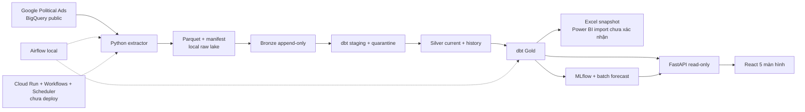
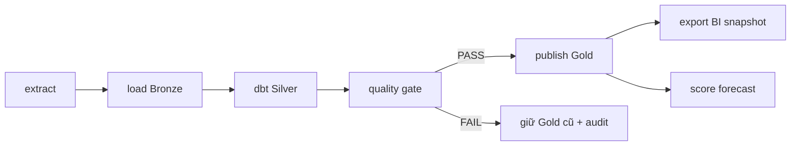
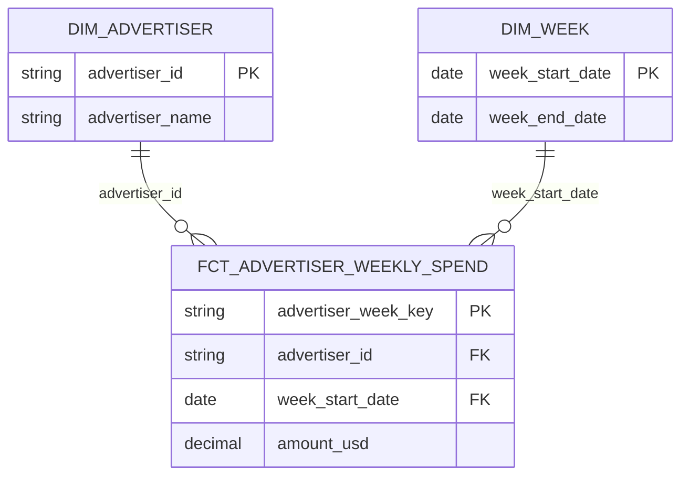
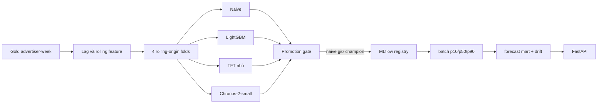

# Tuần 16 — Kiểm thử toàn luồng

## Trạng thái

- Đã chạy từ 20 raw Parquet có sẵn trên máy → Bronze → Silver → Gold → Excel snapshot và forecast → API → React
- Không tải lại BigQuery trong lượt kiểm thử này, số bytes nguồn lấy từ manifest của 20 job lịch sử
- Power BI Cloud và Cloud Run chưa có bằng chứng chạy thật, vì vậy chưa ghi `SQL = Power BI = API = web`
- Bằng chứng máy đọc được: [evidence.json](evidence.json), [Excel ↔ SQL](../week10/evidence.json), [API ↔ SQL](../week14/evidence.json), [web ↔ API ↔ SQL](../week15/evidence.json)

## Kiến trúc và lineage

- Fact grain là `advertiser_id × week_start_date`, tiền USD quan sát được trong 20 tuần đã tải
- `mart_bi_weekly` và `mart_api_advertiser` đều xuất phát từ fact, không cộng `Silver history` vào KPI
- Geo/targeting chưa có Silver đủ tin cậy nên web hiển thị trạng thái thiếu dữ liệu thay vì dựng bản đồ giả

## Kết quả đo trên Mac M3, 8 GB

| Kiểm tra | Kết quả | Phạm vi |
| --- | ---: | --- |
| Raw → Gold, chạy lại | 27,88 giây | `time -l make week6`, 20 raw snapshots đã có, không query BigQuery |
| Max resident set khi chạy lệnh trên | 269 MB | Số `time -l` của lượt chạy, không phải tổng RAM hệ thống |
| Gold | 31.453 dòng, 20 tuần | 0 duplicate key, 16/16 DQ PASS |
| BigQuery processed / billed | 1.388.177.868 / 1.405.091.840 bytes | Tổng job stats trong 20 manifest lịch sử |
| API overview p50 / p95 | 1,29 / 2,32 ms | 50 HTTP request tuần tự localhost, warm cache |
| API RSS | 74,4 MiB | Process server sau benchmark |
| SQL ↔ Excel snapshot | 6/6 KPI | Workbook local, chưa phải report Power BI |
| SQL ↔ API ↔ web | 3/3 KPI | Cùng hash Gold và filter tuần 2026-10-11 |
| Python tests | 63 pass | `make check`, không cần raw hoặc secret |
| Web tests | 3 fixture pass, 1 live pass | Chromium một worker, live test cần Gold/API |
| Terraform | fmt + validate pass | Chưa `apply` |
| Cloud logs / cloud cost | Chưa có | Project chưa bật billing, không gán chi phí giả |

Các con số API là local warm-cache, không đại diện throughput/latency cloud hoặc tải đồng thời

## Thử lỗi và kiểm soát

- Retry: `tests/test_week7_flow.py::test_transform_fails_once_then_retries_same_candidate` mô phỏng transform lỗi lần đầu và retry trên cùng candidate
- Replay/backfill: cùng raw run trả `SKIPPED`, current key không tăng; test source correction giữ history và tạo phiên bản mới
- Schema drift: metadata Parquet lệch bị chặn trước publish; BigQuery cloud mock cũng chặn manifest/Parquet sai checksum
- Quality gate: nếu blocking check fail thì Gold cũ không bị thay, audit FAIL giữ lại
- API failure: thiếu forecast trả 503, query quá timeout bị test; web có loading/empty/error state và Playwright kiểm tra
- Secret scan: `make secrets` quét file được Git track theo pattern high-signal và tên credential; không thay thế GitHub secret scanning chuyên dụng
- Terraform IAM có service account riêng cho extract/publish/workflow/scheduler, runtime không dùng owner/editor toàn project; cấu hình chưa được triển khai thật

## Runbook ngắn

- Raw thiếu hoặc checksum sai → xem `manifest.json`, không sửa tại chỗ; lấy phiên bản mới theo run ID
- `make week6` fail → xem audit FAIL trong warehouse và dbt log, sửa nguồn/code rồi chạy lại; không thay Gold đang phục vụ
- Forecast stale → xác nhận Gold hash, DQ PASS, registry champion, rồi chạy `make week13`
- API 503 → kiểm tra đường dẫn warehouse/forecast và `/api/v1/pipeline-health`; đừng chuyển thành số 0 giả
- Web không lên → chạy API cổng 8000 trước Vite cổng 5173, xem Network tab `/api`
- Cloud chưa deploy → không có log Cloud Run để tra, không bật Scheduler cho đến khi có billing và nghiệm thu thủ công

## Demo 5–7 phút

- 0:00–1:00 — nguồn public, grain advertiser-tuần, giới hạn không có CTR/ROAS
- 1:00–2:00 — manifest → Bronze/Silver/Gold, chạy `make week6` hoặc trình bày audit/DQ
- 2:00–3:00 — trend, top share, HHI và Excel snapshot đối soát với SQL
- 3:00–4:00 — rolling folds, so bốn nhóm model, lý do giữ naive champion
- 4:00–5:30 — mở API docs và React, filter, drill-down, forecast, error/empty state
- 5:30–6:30 — chỉ evidence hash/KPI, benchmark và giới hạn cloud/Power BI

## CV, chỉ dùng khi trình bày đúng phạm vi

- Xây pipeline batch idempotent cho 20 snapshot Google Political Ads, đối soát 31.453 advertiser-week qua Bronze/Silver/Gold với 16 quality checks
- Thiết kế dbt dimensional marts và đối soát 6 KPI SQL–Excel, 3 KPI SQL–FastAPI–React bằng evidence có hash warehouse
- Benchmark naive, LightGBM, TFT và Chronos theo rolling-origin folds; giữ naive sau promotion gate, triển khai batch forecast và drift monitor local
- Xây React dashboard 5 màn hình và FastAPI read-only, kiểm thử 63 Python tests cùng Playwright fixture/live trên Mac 8 GB

Không ghi “đã deploy cloud”, “Power BI Cloud khớp” hoặc “production-ready” trong CV khi chưa có bằng chứng
