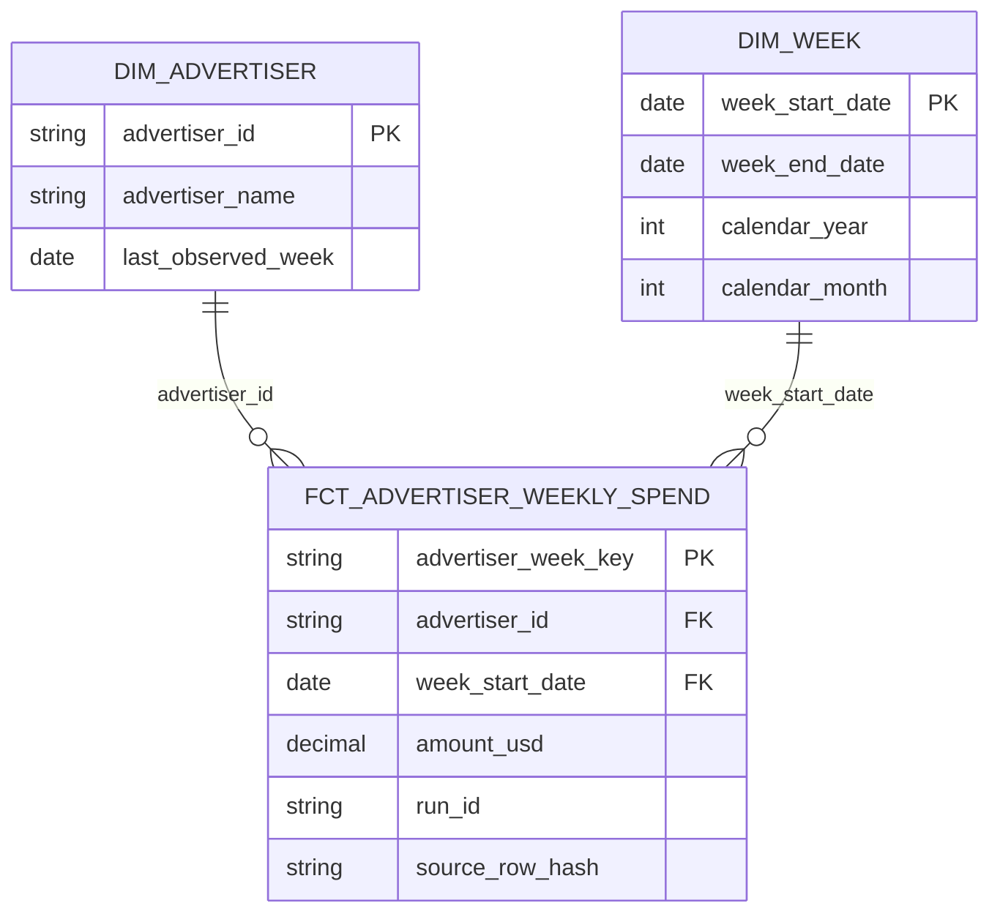

# Tuần 5 — Warehouse và dbt Gold

## Phạm vi

- Input: `silver.weekly_current` trong DuckDB local, được promote sau quality gate Tuần 4
- Grain fact: một `advertiser_id` × một `week_start_date`, đơn vị USD
- Snapshot kiểm chứng: bốn tuần 2026-09-20 đến 2026-10-11, 9.699 fact rows, 3.200 advertiser, tổng 268.708.700 USD
- Đây là tổng của bốn tuần đã tải, không phải tổng lịch sử hay chi tiêu riêng tại Mỹ
- BigQuery Sandbox chưa bật billing và không hỗ trợ DML; Gold chạy local, không tạo tài nguyên cloud

## ERD



`dim_advertiser` là Type 1: tên advertiser mới nhất quan sát được, không phải lịch sử đổi tên

## Metric dictionary

| Metric | Công thức | Grain | Đơn vị / lưu ý |
| --- | --- | --- | --- |
| `amount_usd` | Giá trị `silver.weekly_current.amount_usd` của key hiện hành | advertiser × tuần | USD; không cộng với tiền tệ khác |
| `total_spend_usd` ở trend/BI | `SUM(fact.amount_usd)` | tuần | USD của các advertiser có bản ghi trong tuần |
| `advertiser_count` | `COUNT(*)` trên fact đã unique | tuần | Số advertiser có bản ghi, không phải tổng advertiser toàn nguồn |
| `wow_change_pct` | `100 * (spend_t / spend_t-1 - 1)` | tuần | Chỉ tính khi hai tuần cách đúng 7 ngày và tuần trước > 0; còn lại NULL |
| `total_spend_usd` ở advertiser/API | `SUM(fact.amount_usd)` | advertiser trong cửa sổ đã tải | USD; không tự điền 0 cho tuần không xuất hiện |
| `weeks_observed` | `COUNT(*)` trên fact | advertiser | Số tuần có bản ghi, không phải độ dài lịch liên tục |
| `avg_observed_week_spend_usd` | `AVG(fact.amount_usd)` | advertiser | USD/tuần có quan sát |
| `share_of_observed_spend_pct` | `100 * advertiser_total / SUM(fact.amount_usd)` | advertiser | % tổng USD trong bốn tuần đã tải |
| `spend_rank` | `ROW_NUMBER` theo tổng spend giảm dần, tie-break bằng ID | advertiser | Thứ hạng trong cửa sổ đã tải |

Không có dữ liệu click, conversion, revenue hay spend chính xác theo targeting để tính CTR/ROAS/targeting ROI

## Lineage và serving

```text
silver.weekly_current
├── dim_advertiser ──────────────── mart_advertiser_summary ─ mart_api_advertiser
├── dim_week ─────────────────────────────────────────────── mart_bi_weekly
└── fct_advertiser_weekly_spend
    ├── mart_spend_trend_weekly ──────────────────────────── mart_bi_weekly
    ├── mart_advertiser_summary ──────────────────────────── mart_api_advertiser
    └── mart_targeting_coverage
```

`mart_targeting_coverage` chỉ thông báo trạng thái nguồn: `creative_stats` chưa ingest và `campaign_targeting` rỗng tại lần kiểm tra 2026-10-17. Trường `source_checked_on` là ngày kiểm tra inventory, không phải ngày Gold được build. Không dùng bảng này để suy ra phân bố targeting. `creative_stats` có các trường targeting ở grain ad; muốn phân tích thật phải ingest và kiểm định nguồn này riêng, không join spend weekly trực tiếp vào từng ad

## Chạy và kiểm tra

```bash
make week5
export WEEK4_DB_PATH="$PWD/data/tmp/week4/warehouse.duckdb"
data/tmp/week4/venv/bin/dbt build --project-dir transform --profiles-dir transform
data/tmp/week4/venv/bin/dbt docs generate --project-dir transform --profiles-dir transform
```

Kỳ vọng: `make week5` chạy xanh cả hai lần liên tiếp; full `dbt build` và `dbt docs generate` đều xanh. `gold_reconcile` đối chiếu row count và spend giữa Silver, fact, trend, advertiser, BI và API. `gold_fact_quality` chặn spend âm hoặc tuần không bắt đầu Chủ nhật. dbt docs tạo lineage từ `source` và `ref`; artifact sinh trong `transform/target/` và không commit
