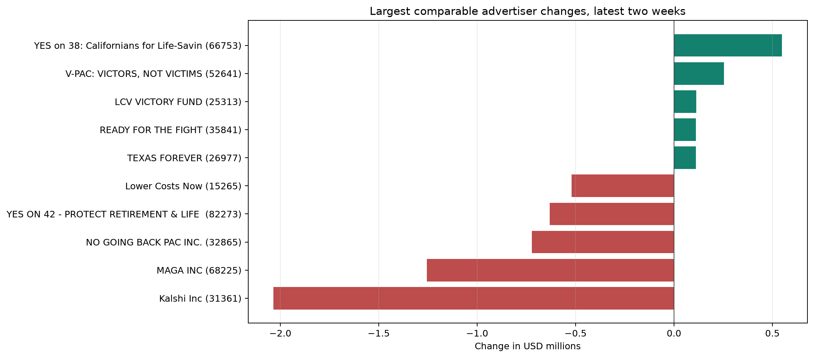

# Tuần 9 — Business insights

## Phạm vi và bằng chứng

- Nguồn: Gold local `fct_advertiser_weekly_spend`, `mart_spend_trend_weekly`, `mart_targeting_coverage`
- Cửa sổ: 4 tuần từ `2026-09-20` đến `2026-10-11`, 9.699 advertiser-week rows, 3.200 advertiser, tổng 268.708.700 USD
- Các số bên dưới là **USD spend được quan sát trong bốn tuần đã tải**, không phải toàn bộ lịch sử, không phải spend riêng tại Mỹ
- [Evidence JSON](evidence.json) lưu số theo tuần, cohort, hash warehouse và hash của từng SQL
- Chạy lại bằng `make week9` từ project root; script chỉ đọc DuckDB, 2 threads, 1 GB memory limit
- SQL nằm trong [thư mục sql](sql/); CSV aggregate và `summary.json` nằm tại `data/tmp/week9/` và không đưa lên Git
- Ảnh PNG được commit để xem ngay trên GitHub; HTML tương tác tạo lại local khi chạy script

## 1 — Spend giảm ở tuần mới nhất

- Kỳ so sánh: `2026-10-04` → `2026-10-11`
- `79.932.300` → `65.042.100 USD`, thay đổi `-18,63%`
- Số advertiser có bản ghi lại tăng từ `2.629` lên `2.923`
- SQL: [01_trend.sql](sql/01_trend.sql), đối soát tổng fact = tổng trend trong script
- Giới hạn: 4 tuần ngắn, độ phủ advertiser thay đổi; không suy ra nguyên nhân hoặc xu hướng dài hạn


## 2 — Tập trung chi tiêu trong nhóm quan sát giảm

- Kỳ so sánh: `2026-09-20` → `2026-10-11`
- Tỷ trọng top 10 advertiser theo từng tuần: `37,31%` → `29,23%`
- HHI quan sát: `261,21` → `128,85` trên thang 0–10.000
- Công thức HHI: `10.000 × SUM((advertiser_spend / weekly_spend)^2)`
- SQL: [02_concentration.sql](sql/02_concentration.sql)
- Giới hạn: HHI chỉ của những advertiser có bản ghi trong từng tuần; không gọi đây là market concentration toàn ngành hoặc đánh giá cạnh tranh pháp lý


## 3 — Spend phân bố lệch ở tuần 2026-10-11

- `1.359` advertiser dưới `1.000 USD`, `908` trong khoảng `1.000–10.000 USD`, chỉ `9` từ `1 triệu USD` trở lên
- Tổng năm bucket = `2.923`, đúng bằng `advertiser_count` của tuần này
- SQL: [03_distribution.sql](sql/03_distribution.sql), median/p90/p99 ở [04_distribution_summary.sql](sql/04_distribution_summary.sql)
- Giới hạn: spend theo một tuần, không phải tổng ngân sách chiến dịch; bucket chứa số 0 trong nhóm dưới 1.000 USD


## 4 — Movers chỉ tính trên nhóm có mặt cả hai tuần

- Kỳ so sánh: `2026-10-04` → `2026-10-11`
- `2.520` advertiser có bản ghi ở cả hai tuần; `403` mới được quan sát ở tuần sau; `109` không có bản ghi ở tuần sau
- Trong nhóm so sánh được, `Kalshi Inc` giảm `2.034.400 USD`; `YES on 38: Californians for Life-Saving Immunology Research and Cures` tăng `548.700 USD`
- SQL: [05_movers.sql](sql/05_movers.sql); biểu đồ chỉ chọn top 5 tăng và top 5 giảm trong cohort `both_weeks`
- Giới hạn: tuần không có bản ghi là *missing*, không tự điền 0; tên advertiser từ dimension Type 1 có thể là tên mới nhất, không nhất thiết tên ở thời điểm cũ



## 5 — Targeting chưa đủ dữ liệu để phân tích business

| Nguồn | Trạng thái theo inventory | Được vẽ targeting? |
| --- | --- | --- |
| `creative_stats` | Chưa ingest vào Silver | Không |
| `campaign_targeting` | Rỗng tại lần kiểm tra 2026-10-17 | Không |

- SQL: [06_targeting_status.sql](sql/06_targeting_status.sql)
- `source_checked_on` là ngày kiểm tra nguồn, không phải ngày build Gold
- Chưa được tính tỷ lệ targeting, targeting ROI, CTR, conversion hay ROAS; muốn phân tích targeting thật phải ingest creative ở grain ad và kiểm tra join/grain trước

## Wireframe cho Tuần 10 và web platform

```text
Executive: KPI spend USD | WoW | advertiser count | trend | top-10 share | HHI
Advertiser: top spenders | movers so được giữa 2 tuần | tìm theo advertiser_id
Distribution: spend buckets | median | p90 | p99 | chọn tuần
Data coverage: kỳ đã tải | targeting readiness | cảnh báo phạm vi và tiền tệ
```

- Bộ lọc tuần phải làm mới cùng lúc tất cả chart và KPI
- Cần hiển thị nhãn `Observed USD spend, loaded weeks` trên dashboard
- Khi đưa vào Power BI Cloud, đối soát ít nhất spend, advertiser count, top-10 share với cùng SQL và cùng filter

## Kiểm tra hoàn thành

- `make week9` tạo 6 SQL, 5 PNG, 5 HTML và evidence JSON
- Fact spend = trend spend; bucket count tuần cuối = advertiser count tuần cuối
- Test synthetic kiểm tra HHI và việc không biến tuần vắng mặt thành 0
- `PATH="$PWD/.venv/bin:$PATH" make check` chạy xanh
